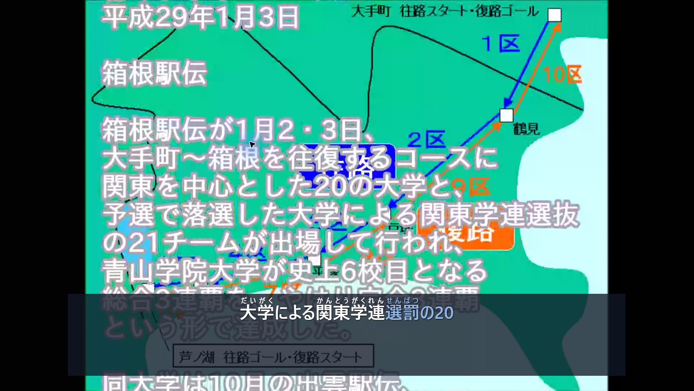
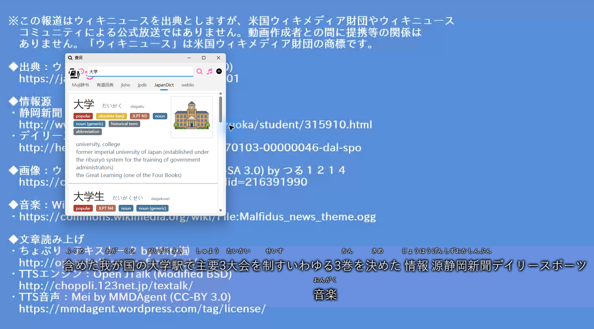

# Kitori: Real-time Japanese Subtitles with Furigana

[简体中文](README.md) · [English](README.en.md) · [日本語](README.ja.md)

Kitori (キトリ) is a shortened form of *kikitori* (聞き取り), Japanese for listening comprehension.

Real-time Japanese subtitles (live captions) with furigana for Windows desktop audio, for people learning Japanese through videos and anime.

It listens to the audio playing on your computer and displays Japanese captions in a floating window, with furigana above the kanji. You can check the original words when you miss a line, or look at the readings when you come across unfamiliar kanji. If you already use LunaTranslator, you can send the captions there and use its dictionary and translation features.

Since it captures desktop audio, it also works with meetings, online classes, livestreams and other audio playing through your speakers or headphones. It isn't tied to a particular website or player. You can choose the recognition language in settings; available languages depend on the model.

The project is still in development (Alpha). A Windows online installer is available, and you can also run it from source.



*The translucent window at the bottom is the generated caption display. White text has been confirmed; light blue text is still being recognized. The large text is part of the original video. Video: Akaniji, CC BY 4.0; map: つる１２１４, CC BY-SA 3.0. [Credits and screenshot notes](docs/images/sources.md).*

## Features

The main goal is to keep captions close to the dialogue, without waiting for a whole passage to finish. Words appear while recognition is still running and are revised as more speech comes in. Furigana updates with the text, with some care taken to keep the display from jumping around.

- Japanese captions with furigana, and separate colors for confirmed text and drafts.
- Centered captions, up to two lines of body text, cleared after a period without new words.
- Adjustable fonts, outlines, shadows, background opacity and caption retention time.
- A standalone desktop overlay that needs no browser tab, with optional Luna output or both displays at once.
- Optional audio lookahead for accessible local media; ordinary live recognition continues when lookahead isn't available.

Audio capture, speech recognition and tokenization use existing open-source components. This project mostly handles when captions update, which words stay on screen, and how readings follow changing text. [Projects used and method references](THIRD_PARTY.md)

## Optional Luna display



*The dictionary window belongs to Luna and needs a dictionary configured there. The entry shown comes from JapanDict / JMdict. Both screenshots use the same openly licensed Japanese news video with synthesized narration, just to show the interface. [Media and dictionary credits](docs/images/sources.md)*

## Recognition and display

| Option | Current support |
| --- | --- |
| Local models | Whisper, Kotoba-Whisper v2, Qwen3-ASR, Voxtral Mini 4B Realtime, ReazonSpeech K2 v2 |
| System captions | Windows Live Captions; enable it and prepare the recognition language in Windows first |
| Display | Standalone overlay, LunaTranslator, or both |
| Settings UI | Chinese, Japanese and English; interface and recognition languages are separate |
| Japanese assistance | Sudachi furigana; optional hallucination phrase blocklist for Whisper/Kotoba |
| Local-file lookahead | Whisper/Kotoba currently; other backends continue live recognition |

Recognition uses local models or Windows Live Captions, without a cloud STT API key. The project produces source-language captions; translation can be supplied by a separately configured Luna installation. [Model and device details](docs/guides/local-models.md) (Chinese)

## Install and run

Open [Kitori-Setup.exe](https://github.com/ZeshiXing/Kitori/releases/download/v0.3.0/Kitori-Setup.exe), choose a folder and a recognition option, then click Install. It prepares a private Python environment, dependencies and the selected runtime. You don't need to install Python first or run as administrator.

| Installation option | When to use it |
| --- | --- |
| Whisper turbo / NVIDIA | Run large-v3-turbo on a compatible NVIDIA GPU |
| Whisper small / CPU | Use small without a compatible GPU; speed depends on your CPU |
| Windows Live Captions | Use system captions on Windows 11; enable the required language pack in Windows |

The installer needs an internet connection. Whisper downloads a roughly 5.1 GB Tiger runtime and a 0.5–1.6 GB model; allow 20 GB of free disk space. The Windows Live Captions option skips those downloads. You can also select Luna during installation. If a download fails, run setup again to resume.

When installation finishes, open settings to choose the recognition language and display. Defaults are Japanese and the standalone overlay; you can change models later. [Installation details](docs/guides/installation.md) (Chinese)

| Entry point | Action |
| --- | --- |
| `Start-Local.cmd` | Start the standalone overlay |
| `Start-Luna.cmd` | Display captions through an installed Luna |
| `Start-Both.cmd` | Display through both |
| `Settings.cmd` | Open settings |
| `Stop.cmd` | Exit the caption application |

Audio comes from the default output device. Restart after changing headphones or speakers. Closing settings leaves captions running. [Settings guide](docs/guides/settings.md) (Chinese)

### Install from source

After downloading the source, open `Install.cmd` to prepare the environment automatically. It selects Whisper turbo if NVIDIA tools are found, otherwise CPU small. Manual installation steps are in the installation guide. Source installations require Windows x64 and Python 3.11+; the dependency lock uses Python 3.13.

## Things to keep in mind

Short lines, background music, overlapping speakers and names can cause recognition errors. Furigana can be wrong too. If you're using this to study, replay or look up anything that doesn't make sense. Speed and accuracy depend on the model, your computer and the audio. 

Whisper, Kotoba, Qwen and Reazon currently update captions by repeatedly decoding a rolling audio window. Voxtral uses its realtime interface. A short update interval therefore doesn't tell you how long a caption will take to appear. Confirmed text can still contain recognition errors.

Desktop capture only hears audio already being played. Lookahead currently works with Whisper/Kotoba and accessible local media, not DRM-protected sites. Continuous synchronization with an Edge web player's clock hasn't been added yet.

Luna integration doesn't change its EXE, DLLs or source. The furigana extension does use version-dependent renderer interfaces, so it may need checking after Luna updates.

## Privacy and development

During normal use, captured audio isn't saved to disk and default logs don't include recognized text. A limited recent caption history stays in memory. The local service listens only on `127.0.0.1`, with a new token each time it starts for interfaces that accept captions. Model and runtime downloads need an internet connection. Luna's online dictionaries and translators make their own network requests if you enable them.

```powershell
.\.venv\Scripts\python.exe -m unittest discover -s tests -v
```

Automated checks are separate from real-model, desktop-audio and rendering validation. [Contributing and naming](CONTRIBUTING.md) · [Runtime diagnostics](tools/diagnostics/README.md) · [Release checklist](docs/development/release.md) (detailed guides are currently in Chinese)

## License and acknowledgments

Project-owned code is licensed under **GPL-3.0-only**; see [LICENSE](LICENSE). External code, models, dictionaries, runtimes and demo media retain their own licenses. Project-owned screenshot contributions use **CC BY-SA 4.0**, with explicit exceptions for third-party UI, illustrations and marks; see the asset notices.

Thanks to Whispering Tiger, faster-whisper, LunaTranslator, Sudachi, Silero VAD and the open-source streaming ASR projects used as component or method references. [Third-party notices](THIRD_PARTY.md) · [Demo and screenshot credits](docs/images/sources.md) · [Distribution notes](docs/development/licensing.md)
